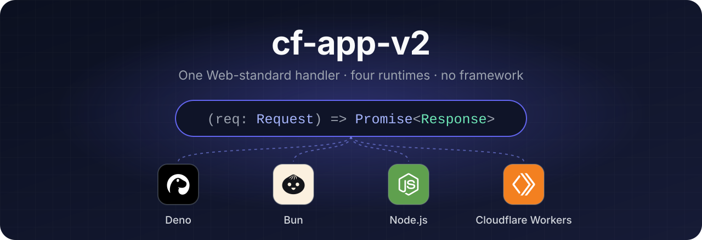
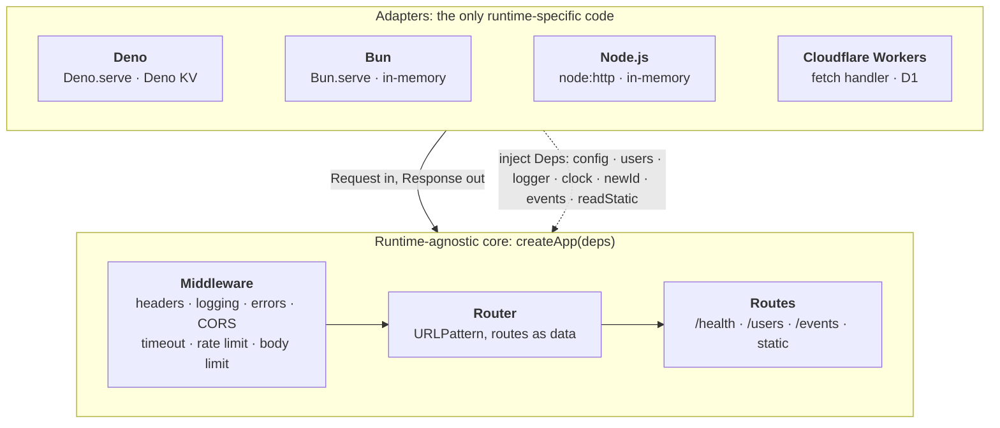

<div align="center">



<br/>
<br/>

[](https://deno.com)
[](https://bun.sh)
[](https://nodejs.org)
[](https://workers.cloudflare.com)
<br/>
[](https://www.typescriptlang.org)
[](https://zod.dev)
[](https://tailwindcss.com)
[](LICENSE)

**A small, production-minded HTTP server starter in TypeScript.**<br/> One pure, Web-standard handler that runs
unchanged on four runtimes, with a Tailwind CSS frontend,<br/> OWASP-aligned defaults, and 145 tests that need no
server, no network and no permissions.

[Quick start](#quick-start) · [Architecture](#architecture) · [API](#api) · [Security](#security) ·
[Deployment](#deployment) · [Configuration](#configuration)

</div>

---

## Highlights

- **One handler, four runtimes.** The whole app is `(req: Request) => Promise<Response>`, built only on Web standards
  (Fetch, URL, URLPattern, Headers, ReadableStream, TextEncoder, `crypto.subtle`). Each runtime gets one thin adapter
  file.
- **Side effects at the edges.** Storage, logging, time, randomness and file reads are injected through a single `Deps`
  object. The core is plain functions and plain data: no classes, no decorators, no framework.
- **Secure by default.** Strict CSP, allowlist validation with zod, body-size limits before parsing, exact-origin CORS,
  rate limiting, constant-time token checks, and no stack traces in responses.
- **Tested without a server.** Tests call `app(new Request(...))` directly with in-memory fakes. The D1 store's SQL runs
  against real SQLite.
- **Live, framework-free UI.** A Tailwind CSS v4 page with server-sent events and no inline scripts or styles. User data
  is only ever written with `textContent`.
- **A tiny dependency surface.** [zod](https://zod.dev) at runtime and Tailwind at build time. Nothing else.

## Quick start

<table>
  <tr>
    <th align="center"><br/>Deno <sub>2.x</sub></th>
    <th align="center"><br/>Bun <sub>≥ 1.3</sub></th>
    <th align="center"><br/>Node.js <sub>≥ 24</sub></th>
    <th align="center"><br/>Cloudflare Workers</th>
  </tr>
  <tr>
    <td><code>deno task dev</code></td>
    <td><code>bun install</code><br/><code>bun run dev:bun</code></td>
    <td><code>npm install</code><br/><code>npm run dev:node</code></td>
    <td><code>npm install</code><br/><code>npm run dev:worker</code></td>
  </tr>
  <tr>
    <td align="center"><sub>Deno KV</sub></td>
    <td align="center"><sub>in-memory</sub></td>
    <td align="center"><sub>in-memory</sub></td>
    <td align="center"><sub>D1 (SQLite)</sub></td>
  </tr>
</table>

Then open <http://127.0.0.1:8000> (Workers: <http://127.0.0.1:8787>). Every `dev` script runs the Tailwind watcher
alongside an auto-restarting server.

## Architecture



`createApp(deps)` returns the handler. It imports nothing runtime-specific, so the same code runs everywhere and in
tests. Each adapter does exactly three things:

1. **Validates config** with the shared zod schema and fails loudly on bad values. Error messages name the key and never
   echo its value.
2. **Builds the real dependencies**: user storage, a log writer, `readStatic`, the clock and timers, and the id
   generator.
3. **Starts the server**, converting between the platform and Fetch `Request`/`Response` where needed (Node).

Anything that mentions `Deno.`, `Bun.`, `process` or `node:` lives only in `src/adapters/`.

| Runtime                                                                                      | User storage     | Static files       | Client IP from             |
| -------------------------------------------------------------------------------------------- | ---------------- | ------------------ | -------------------------- |
|  Deno                             | Deno KV          | `Deno.readFile`    | `info.remoteAddr`          |
|  Bun                               | in-memory        | `Bun.file`         | `server.requestIP()`       |
|  Node.js                          | in-memory        | `node:fs/promises` | `req.socket.remoteAddress` |
|  Cloudflare Workers | D1 database `DB` | `ASSETS` binding   | `CF-Connecting-IP`         |

### Side effects at the edges

The core takes inputs and returns outputs. Everything that touches the outside world arrives through `Deps`:

```ts
interface Deps {
  config: AppConfig; // validated once, at startup
  users: UserStore; // user records (KV or D1, chosen by the adapter)
  rateLimitStore: RateLimitStore; // rate-limit counters
  logger: Logger; // writes through an injected (line: string) => void
  clock: Clock; // now(), after(), every(): time and timers
  newId: () => string; // randomness
  events: EventBus; // pub/sub feeding server-sent events
  readStatic: ReadStatic; // file reads
}
```

The core never calls `Date.now()`, `setTimeout`, `crypto.randomUUID()`, `console` or the file system. Each middleware
and route factory receives only the dependencies it uses (for example `rateLimit({ store, clock, logger, … })`), so each
one can be read and tested on its own. That is why `deno task test` passes with every permission denied.

### Request pipeline

Middleware is `(next: Handler) => Handler`, and `compose(a, b, c)` runs a → b → c → router. The order in
[`src/app.ts`](src/app.ts) is deliberate:

| # | Middleware        | Why it sits here                                                              |
| - | ----------------- | ----------------------------------------------------------------------------- |
| 1 | `securityHeaders` | Every response, including errors and rejections, gets the headers             |
| 2 | `requestLogger`   | Sees the final status; logs at `debug`, so it is silent by default            |
| 3 | `errorBoundary`   | Any throw becomes a generic 500 with an `errorId`; details go only to the log |
| 4 | `cors`            | Answers preflights and rejects disallowed origins before any work is done     |
| 5 | `timeout`         | 503 if no response arrives within `REQUEST_TIMEOUT_MS`                        |
| 6 | `rateLimit`       | A cheap counter check before the body is read; `/health` is exempt            |
| 7 | `bodyLimit`       | Rejects oversized bodies before anything parses them                          |
| 8 | router            | Plus route-level middleware, such as the auth hook on `DELETE /users/:id`     |

### Storage

Routes depend on a four-method `UserStore` interface (`create`, `find`, `listNewest`, `delete`) with two
implementations:

- **`createKvUserStore(kv)`** ([`src/users.ts`](src/users.ts)) works on any `KvStore`. It keeps a newest-first index key
  for listing and claims each email with an atomic `setIfAbsent`.
- **`createD1UserStore(db)`** ([`src/adapters/worker.ts`](src/adapters/worker.ts)) uses SQL. A `UNIQUE` email column
  enforces uniqueness, and `ORDER BY … LIMIT` handles listing. The table is created on first use.

Emails are unique regardless of case on every runtime. To use Redis, Postgres or anything else, implement `KvStore` or
`UserStore` in an adapter. Nothing else changes.

<details>
<summary><b>Project layout</b></summary>

```
src/
  core/                  runtime-agnostic, no side effects of its own
    types.ts             Handler, Middleware, Deps and the storage/clock/logger interfaces
    router.ts            URLPattern router: routes are data, matching is a pure function
    middleware.ts        compose + logger, error boundary, CORS, security headers,
                         timeout, rate limit, body limit, auth hook
    http.ts              pure response helpers (json, text, notFound, badRequest, …)
    validate.ts          zod helpers: parseJson / parseQuery / parseParams → Result
    static.ts            path sanitizing, Content-Type, cache headers, ETags
    config.ts            the config schema, parsed once at startup
    auth.ts, crypto.ts, log.ts, request.ts, sse.ts
  routes/                one file per concern: users, events (SSE), static, health
  users.ts               user schemas (types come from z.infer), UserStore, KV-backed store
  stores/memory.ts       in-memory KV, rate-limit counters and event bus
  app.ts                 createApp(deps): wires routes and middleware
  adapters/
    deno.ts bun.ts node.ts worker.ts   the only files with runtime-specific code
    common.ts            shared adapter helpers (Web-standard globals only)
public/                  served as-is: index.html, app.js, lib.js, favicon.svg, styles.css (built)
frontend/styles.css      Tailwind entry point
tests/                   Deno tests that call app(new Request(...)) directly
docs/assets/             README artwork
```

</details>

## API

| Method   | Path         | Description                                                                               |
| -------- | ------------ | ----------------------------------------------------------------------------------------- |
| `GET`    | `/health`    | `{ "ok": true }`                                                                          |
| `GET`    | `/users`     | `?limit=1..100`, newest first                                                             |
| `POST`   | `/users`     | JSON `{ name, email }`, strict schema; `201` + `Location`, or `409` if the email is taken |
| `GET`    | `/users/:id` | `id` must be a UUID                                                                       |
| `DELETE` | `/users/:id` | Requires `Authorization: Bearer $ADMIN_TOKEN`                                             |
| `GET`    | `/events`    | Server-sent events: `ready`, `ping`, `user.created`, `user.deleted`                       |
| `GET`    | `/*`         | Static files from `public/` (`/` → `index.html`)                                          |

Errors share one JSON shape, `{ "error": "code", "message": "…", ...details }`. Validation failures list each issue:

```json
{
  "error": "validation_failed",
  "message": "Invalid request body",
  "issues": [{ "path": "email", "code": "invalid_format", "message": "Enter a valid email address" }]
}
```

## Security

The defaults follow the OWASP Top 10 and ASVS where they apply.

| Control                              | Implementation                                                                                                                        |
| ------------------------------------ | ------------------------------------------------------------------------------------------------------------------------------------- |
| Allowlist validation of all input    | zod `.strict()` schemas for body, params and query; Unicode-aware name allowlist                                                      |
| Request size limit before parsing    | `bodyLimit`: Content-Length first, then a byte counter for chunked bodies                                                             |
| No internals in errors               | `errorBoundary`: generic 500 + `errorId`; the stack goes only to the server log                                                       |
| Security headers                     | Strict CSP (no inline script or style), nosniff, `Referrer-Policy`, `X-Frame-Options` + `frame-ancestors`, COOP/CORP, HSTS over HTTPS |
| CORS                                 | Exact-origin allowlist from config; `*` is rejected at startup                                                                        |
| Secrets                              | Only from validated config; never logged; sensitive log keys redacted                                                                 |
| Constant-time token comparison       | `timingSafeEqual`: SHA-256 both sides, then compare in constant time                                                                  |
| Authentication hook                  | `requireAuth({ authenticate })`; `bearerTokenAuth` fails closed when no token is set                                                  |
| Rate limiting                        | `rateLimit` on an injected `RateLimitStore`; 429 + `Retry-After`                                                                      |
| Timeouts                             | Per-request `timeout` middleware, plus server timeouts in the Node and Bun adapters                                                   |
| Correct Content-Type, encoded output | Every helper sets Content-Type; the frontend only uses `textContent`                                                                  |
| Path traversal                       | `sanitizeStaticPath` allowlist + a `resolveInside` check in each adapter                                                              |
| Security event logging               | `validation_failed`, `auth_failed`, `rate_limited`, `cors_origin_denied`, `body_too_large`, `static_path_rejected`                    |

- **Client IP:** each adapter writes the socket address into an internal header and always overwrites any value the
  client sent. `X-Forwarded-For` and `X-Forwarded-Proto` are honoured only with `TRUST_PROXY=true`; enable that only
  behind exactly one trusted proxy.
- **Outbound calls:** the app makes none. If you add some, inject `fetch` through `Deps` and pass
  `AbortSignal.timeout(ms)`.

## Design principles

These follow the Unix philosophy:

- **Do one thing well.** Every middleware is a separate factory and every route has its own file. Validation,
  static-path rules and response building are separate pure modules.
- **Compose small pieces.** The app is `compose(...middleware)(router)`. Route-level middleware uses the same shape.
- **Plain interfaces.** Functions take data and return data. Logs are line-delimited JSON on stderr (stdout on Workers).
- **Fail loudly, stay quiet on success.** Bad config stops startup with a clear error. Successful requests log nothing
  at the default `info` level; security events log at `warn`.
- **Minimal, replaceable dependencies.** Storage, clock and logging are interfaces with in-memory defaults.

## Frontend

[`public/index.html`](public/index.html) lists users, has a form to create one, and updates live over server-sent
events. The JavaScript is plain ES modules, type-checked with JSDoc (`// @ts-check`), with no build step:

- [`public/lib.js`](public/lib.js) holds the pure helpers (shape checks, sorting, error messages, formatting). They are
  unit-tested.
- [`public/app.js`](public/app.js) holds the edges: `fetch`, DOM updates and `EventSource`. Rows are cloned from a
  `<template>` and filled with `textContent`; `innerHTML` is never used for data.

**Tailwind CSS v4** is compiled at build time by `@tailwindcss/cli` from [`frontend/styles.css`](frontend/styles.css)
into `public/styles.css`, which is git-ignored. The CDN/play script is not used, because it injects inline styles that
the strict CSP would block. `@source` lists exactly the files to scan.

```sh
deno task build:css   # or: npm run build:css    one-off, minified
deno task dev:css     # or: npm run watch:css    rebuild on change
```

## Deployment

###  Deno

```sh
deno task dev     # watch mode
deno task start   # build CSS, then serve
```

Permissions are scoped to `--allow-net --allow-env --allow-read=public`. `--unstable-kv` enables Deno KV, which persists
in Deno's cache directory.

###  Bun

```sh
bun install
bun run start:bun     # or: bun run dev:bun
```

###  Node.js

```sh
npm install
npm run start:node    # or: npm run dev:node
```

Node 24 or later is required: it provides the global `URLPattern` and runs `.ts` files directly.

###  Cloudflare Workers

```sh
npm install
npm run dev:worker                       # local workerd, with a local D1
npm run deploy:worker
npx wrangler@4 secret put ADMIN_TOKEN    # optional
```

- **No manual setup.** The D1 binding in [`wrangler.jsonc`](wrangler.jsonc) has a `database_name` but no ID. On the
  first deploy, Wrangler (4.45+) connects to the database with that name, or creates it. The `users` table is created on
  first use. Move to `wrangler d1 migrations` once the schema needs to change.
- **Git integration (Workers Builds):** use `npm run build:css` as the build command and `npx wrangler deploy` as the
  deploy command.
- **Static files** go through the `ASSETS` binding with `run_worker_first`, so they get the same headers and checks.
- **Per-isolate state:** rate-limit counters and SSE subscribers live per isolate (best effort). Put a Durable Object or
  the Rate Limiting binding behind the same interfaces for global guarantees.

> [!NOTE]
> The `dev:*` npm scripts use `&` to run the CSS watcher alongside the server, so they need a POSIX shell.
> `deno task dev` works everywhere.

## Configuration

All variables are optional and validated at startup; blank means "use the default". Export them in your shell, or load a
`.env` file: Bun reads it automatically, Deno and Node need `--env-file`, and Workers read `.dev.vars` locally. See
[`.env.example`](.env.example).

| Variable                 | Default             | Notes                                                  |
| ------------------------ | ------------------- | ------------------------------------------------------ |
| `PORT`, `HOST`           | `8000`, `127.0.0.1` | Use `HOST=0.0.0.0` in containers                       |
| `LOG_LEVEL`              | `info`              | `debug` adds one line per request                      |
| `CORS_ORIGINS`           | (none)              | Comma-separated exact origins; `*` is rejected         |
| `CORS_ALLOW_CREDENTIALS` | `false`             |                                                        |
| `TRUST_PROXY`            | `false`             | Honour `X-Forwarded-*` from one trusted proxy          |
| `MAX_BODY_BYTES`         | `16384`             |                                                        |
| `REQUEST_TIMEOUT_MS`     | `10000`             |                                                        |
| `RATE_LIMIT_MAX`         | `100`               | Requests per window per client IP                      |
| `RATE_LIMIT_WINDOW_MS`   | `60000`             |                                                        |
| `SSE_HEARTBEAT_MS`       | `15000`             | 1–60 s                                                 |
| `ADMIN_TOKEN`            | (unset)             | ≥ 32 chars; unset means admin routes always return 401 |

## Testing

```sh
deno task test    # 145 tests, run with no permissions
deno task check   # type-checks src/ (all four adapters), tests/ and the frontend JS
deno task lint    # deno lint + deno fmt --check
```

Tests call `app(new Request(...))` with in-memory fakes: a fake clock fires timers on demand, a fake `readStatic`
records every path it is asked for, and the D1 store runs on in-memory SQLite. Coverage includes routing, validation,
middleware order, server-sent events, the frontend helpers and the Worker adapter. The security suite checks:

- oversized and chunked bodies
- unknown fields
- disallowed origins
- security headers on every response type
- rate limiting, including spoofed `X-Forwarded-For`
- encoded path-traversal attempts, which never reach the file reader
- 500 responses with no stack trace
- secrets kept out of logs

## License

[MIT](LICENSE) © 2026 Pedro M. Dominguez

<sub>Deno, Bun, Node.js and Cloudflare Workers are trademarks of their respective owners. Their logos are used here only
to show compatibility and come from <a href="https://simpleicons.org">Simple Icons</a> (CC0).</sub>
